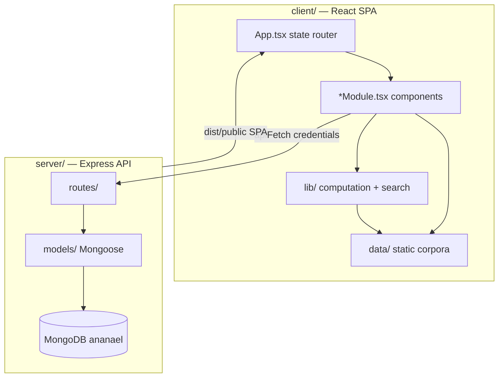
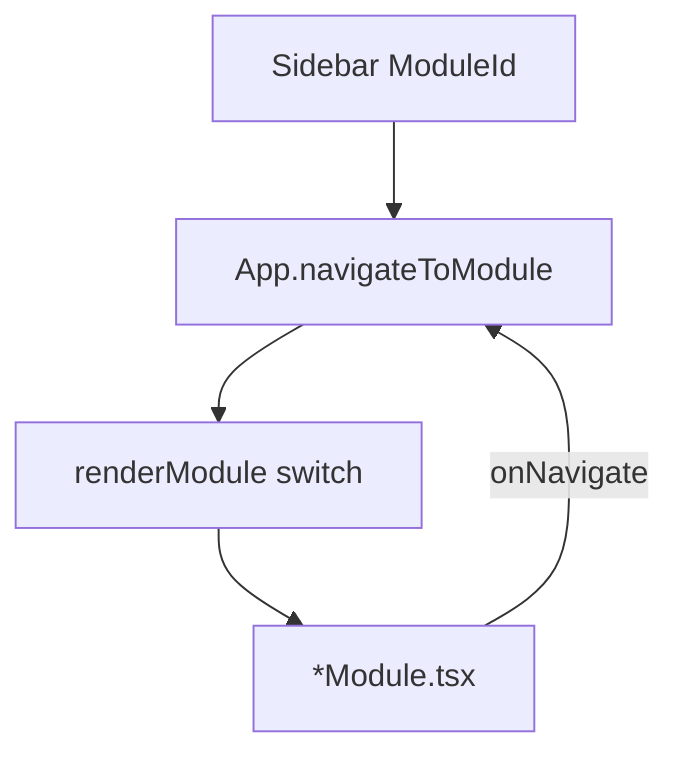

# Ananael Architecture

Codebase structure, conventions, and extension patterns for contributors and maintainers.

For deployment and local dev, see [README.md](../README.md). For phased feature scope and done-when criteria, see [ROADMAP.md](../ROADMAP.md). For a potential future share/lodge layer (not started), see [SOCIAL-ROADMAP.md](SOCIAL-ROADMAP.md).

---

## At a glance

Ananael is a **modular esoteric dashboard**: a React SPA backed by Express and MongoDB. Most knowledge lives in **client-side TypeScript corpora** (`client/src/data/`) with computation and cross-module wiring in `client/src/lib/`. The server handles **authentication** and **user-generated persistence** (journal, saved layouts, designs, notes).



**Design principles**

- **Guest-friendly** — core tools work without login; saves require auth.
- **Client-first calculation** — deterministic tools run in the browser; Express persists results.
- **Sidebar modules** — each feature is a `ModuleId` wired through `App.tsx`, not URL routes.
- **Unified journal** — divination casts and ritual-runner sessions land in `JournalEntry`.

---

## Repository map

| Path | Purpose |
|------|---------|
| `client/` | React + Vite + TypeScript SPA |
| `server/` | Express API, Mongoose models, Docker multi-stage build |
| `docker-compose.yml` | Production stack: MongoDB + single server container |
| `docs/` | Architecture and contributor docs |
| `README.md` | Pitch, deploy, local dev |
| `ROADMAP.md` | Phased feature plan |

### `client/src/`

| Path | Purpose |
|------|---------|
| `main.tsx` | React entry; wraps `App` in `AuthProvider` |
| `App.tsx` | Shell: sidebar, module routing, cross-module navigation state |
| `components/` | One `*Module.tsx` per sidebar feature (~19 components) |
| `data/` | Static typed corpora (correspondences, tarot, liturgy, chakras, etc.) |
| `lib/` | Computation, search, API helpers, cross-module wiring |
| `context/` | `AuthContext.tsx` — JWT session, location, natal profile |
| `public/assets/` | Tarot deck, Goetia seals, other static art |

### `server/src/`

| Path | Purpose |
|------|---------|
| `server.ts` | Express app, middleware, route mounting, SPA static serve |
| `routes/` | REST endpoints per domain (auth, journal, tarot, liturgy, …) |
| `models/` | Mongoose schemas for user-generated data |
| `middleware/` | JWT auth (`protect`), CSRF |
| `config/db.ts` | MongoDB connection |
| `services/` | e.g. `migrateJournal.ts` (legacy → journal migration) |
| `lib/` | Auth cookie, CORS origins, presence tracking |

---

## Runtime model

| Mode | Client | Server | Notes |
|------|--------|--------|-------|
| **Local dev** | Vite `:5173` | Express `:5000` | Vite proxies `/api` → server |
| **Production** | Built to `client/dist/` | Express `:5000` | Single process serves API + SPA |

Docker Compose runs MongoDB and one `ananael-server` container. Express serves `/api/*` and the built React app from `dist/public/`, with SPA fallback for non-API routes.

Env vars, HTTPS, and Portainer setup: see [README.md](../README.md).

---

## Module system

Navigation is **React state**, not a URL router. The sidebar defines modules; `App.tsx` switches on `activeModule`.



### Registration

1. Add `ModuleId` union member in [`client/src/components/Sidebar.tsx`](../client/src/components/Sidebar.tsx).
2. Add entry to `MODULES` array (sidebar label).
3. Add to `MODULE_SELECT_GROUPS` for mobile `<select>`.

### Rendering

[`App.tsx`](../client/src/App.tsx) holds `activeModule` state and a `renderModule()` switch that mounts the matching `*Module.tsx`.

### Deep linking

`navigateToModule(module, opts?)` accepts typed `AppNavigateOptions`:

| Option | Target module |
|--------|---------------|
| `gematriaPrefill` | Gematria |
| `correspondencesQuery` | Correspondences |
| `filter`, `entryId` | Journal |
| `divinationTab` | Divination (tarot / iching / geomancy / runes) |
| `planetaryPanel` | Celestial Timing (hours / planets / zodiac / elections / almanac / natal) |
| `ritualTemplate` | Ritual Space Planner |
| `talismanPrefill` | Talisman Atelier |
| `opusPane`, `stageId`, `metal` | Athanor |
| `riteId`, `runEntryId`, `liturgyMode` | Ritual Library |
| `subtleBodyPane`, `subtleBodyFocus` | Subtle Body |
| Tree options (`TreeNavigateOptions`) | Tree of Life |

Modules receive `onNavigate` and `initial*` props to honor deep links from Magical OS and other modules.

### Legacy aliases

`tarot` and `iching` `ModuleId` values resolve to `divination` with the correct tab preselected.

### Composite shells

Some sidebar entries host sub-features:

| Shell | Sub-features |
|-------|--------------|
| **Divination** | Tarot, I Ching, Geomancy, Runes (tabs) |
| **Celestial Timing** | Hours, Planets, Zodiac, Elections, Almanac, Natal (panels) |
| **Athanor** | Stages, Vessel, Emblem (panes) |
| **Subtle Body** | Chakras, Meridians, Maps, Neidan (panes) |
| **Ritual Library** | Browse + Ritual Runner (`RitualRunnerPanel.tsx`) |

---

## Layer conventions

| Layer | Role | Examples |
|-------|------|----------|
| `data/` | Static corpus, IDs, basic lookups | `correspondences.ts`, `liturgy.ts`, `chakras.ts` |
| `lib/` | Algorithms, search, cross-module bridges, API glue | `correspondences.ts`, `ritualRunner.ts`, `planetaryHours.ts` |
| `components/` | UI only; receives `onNavigate` and `initial*` props | `CorrespondencesModule.tsx` |

**Rule of thumb:** if it is a table of facts, it belongs in `data/`. If it computes, searches, or connects modules, it belongs in `lib/`.

### Persistence decision tree

```
Need to persist user work?
├── no  → client data/ + lib/ only
└── yes
    ├── Divination cast or ritual session? → JournalEntry (journal routes)
    └── Layout, design, or study note?     → dedicated model + route
```

---

## Module inventory

Structural map of all 15 sidebar modules. Phase history and done-when criteria: [ROADMAP.md](../ROADMAP.md).

| Module | `ModuleId` | Component(s) | Data | Lib | API / persistence |
|--------|------------|--------------|------|-----|-------------------|
| Magical OS | `dashboard` | `DashboardModule.tsx` | `splashFeatures.ts` | `almanac`, `journal`, `journalSky`, `natalPersonalization` | Auth profile (`/api/auth/location`, `/api/auth/natal`) |
| Divination | `divination` | `DivinationModule.tsx`, `TarotModule`, `IChingModule`, `GeomancyModule`, `RunesModule` | `tarotDeck`, `tarotDeckArt`, `tarotCombos`, `iching`, `ichingCorrespondences`, `geomancy`, `runes` | `iching`, `geomancy`, `runes`, `tarotSummary` | Journal saves (`/api/tarot`, `/api/iching`, `/api/geomancy`, `/api/runes`) |
| Magical Journal | `journal` | `JournalModule.tsx` | — | `journal`, `journalSky` | `/api/journal/entries` |
| Gematria | `gematria` | `GematriaModule.tsx` | `data/gematria/` | `gematria` | `/api/gematria/save` → `GematriaQuery` |
| Celestial Timing | `planetary` | `CelestialTimingModule.tsx` | `birthstones` | `planetaryHours`, `celestialEphemeris`, `westernZodiac`, `hinduAstrology`, `chineseAstrology`, `elections`, `almanac`, `natalChart`, `natalProfile`, `planetaryLocation`, `planetaryPanel`, `moonPhase` | `/api/planetary/charts` → `PlanetaryChart` |
| Script Translator | `translator` | `ScriptTranslatorModule.tsx` | `data/scripts/` | `transliterate` | Client-only |
| Tree of Life | `tree` | `TreeOfLifeModule.tsx` | `treeOfLife` | `svgExport` | `/api/tree/notes` → `TreeNote` |
| Correspondences | `correspondences` | `CorrespondencesModule.tsx` | `correspondences` | `correspondences` | Client-only |
| Athanor | `opus` | `AlchemyModule.tsx` | `alchemy` | `alchemy`, `alchemicalGlyphPaths` | `/api/opus/vessels` → `OpusVessel` |
| Ritual Space Planner | `ritual` | `RitualSpaceModule.tsx` | `ritualTools` | `svgExport` | `/api/ritual/layouts` → `RitualLayout` |
| Solomonic Circles | `solomonic` | `SolomonicCircleModule.tsx` | `solomonicCircles`, `arsGoetia` | `solomonicGeometry`, `goetiaSealArt` | `/api/solomonic/circles` → `SolomonicCircle` |
| Talisman Atelier | `talisman` | `TalismanModule.tsx` | — | `kamea`, `sigil`, `ofuda`, `sutras` (data), `svgExport` | `/api/talisman/designs` → `TalismanDesign` (`kamea` \| `sigil` \| `sutra`) |
| Enochian | `enochian` | `EnochianModule.tsx` | `enochian` | — | `/api/enochian/notes` → `EnochianNote` |
| Ritual Library | `liturgy` | `LiturgyModule.tsx`, `RitualRunnerPanel.tsx` | `liturgy` | `ritualRunner` | Client corpus; runner → journal; `/api/liturgy/rites` (metadata catalog) |
| Subtle Body | `subtleBody` | `SubtleBodyModule.tsx` | `chakras`, `meridians`, `subtleBodyMaps`, `nakshatraChakras` | `subtleBody`, `subtleBodyCounsel` | `/api/practice/vessels` → `PracticeVessel`; client corpus otherwise |

---

## Cross-cutting systems

### Authentication

- JWT stored in **HttpOnly cookie** (`AUTH_COOKIE`).
- [`client/src/lib/api.ts`](../client/src/lib/api.ts) — `apiFetch()` always sends `credentials: 'include'`. Do not use `Authorization` headers.
- **Guest mode** — logged-out visitors can enter as guest and use client-side tools; persistence requires login.
- **CSRF** — mutating requests protected when auth cookie is present (`server/src/middleware/csrf.ts`).

### Journal hub

[`JournalEntry`](../server/src/models/JournalEntry.ts) is the unified log for ritual, dream, divination, mood, working, and note entries.

| Field | Purpose |
|-------|---------|
| `entryType` | `ritual`, `dream`, `divination`, `mood`, `working`, `note` |
| `entities[]` | Tagged entities (`kind` + `id` + `label`) — sephirah, planet, chakra, hexagram, etc. |
| `payload` | Module-specific JSON (spread cards, hexagram lines, ritual run state) |
| `sky` | Moon phase, planetary hour, zodiac context at time of entry |
| `links[]` | Cross-references to other persisted documents |

Divination saves (`/api/tarot/save`, `/api/iching/save`, etc.) write `JournalEntry` documents. Ritual Runner sessions persist here too.

### Correspondences bridge

[`client/src/lib/correspondences.ts`](../client/src/lib/correspondences.ts) is the cross-module encyclopedia layer. It consumes `data/correspondences.ts` and links outward to chakras, I Ching trigrams, liturgy rites, tree nodes, alchemy metals, and more. When adding a new corpus, wire search facets and deep-link targets here.

### Magical OS

Default home module (`dashboard`). Composes sky conditions, quick divination, journal summaries, and tile deep-links into every other module via `onNavigate`.

### UI conventions

- Tailwind CSS with `ananael-*` theme tokens (dark esoteric palette).
- Components named `*Module.tsx`, one per sidebar `ModuleId`.
- Shared search chrome and SVG export utilities in `lib/svgExport.ts`.

---

## Backend reference

### Route → model map

| Route prefix | Model(s) | Notes |
|--------------|----------|-------|
| `/api/auth` | `User` | Register, login, profile, location, natal |
| `/api/journal` | `JournalEntry` | CRUD + legacy migration |
| `/api/tarot` | `JournalEntry` (+ legacy `TarotReading`) | Save + history |
| `/api/iching` | `JournalEntry` (+ legacy `IChingCast`) | Save + history |
| `/api/geomancy` | `JournalEntry` | Save |
| `/api/runes` | `JournalEntry` | Save |
| `/api/gematria` | `GematriaQuery` | Save queries |
| `/api/tree` | `TreeNote` | Study notes |
| `/api/ritual` | `RitualLayout` | Altar layouts |
| `/api/solomonic` | `SolomonicCircle` | Circle designs |
| `/api/talisman` | `TalismanDesign` | Talisman designs |
| `/api/planetary` | `PlanetaryChart` | Chart bookmarks |
| `/api/opus` | `OpusVessel` | Athanor vessels |
| `/api/enochian` | `EnochianNote` | Study notes |
| `/api/liturgy` | — | Metadata catalog only; rite content is client-side |

Liturgy rite **content** lives in [`client/src/data/liturgy.ts`](../client/src/data/liturgy.ts). The server `GET /api/liturgy/rites` returns a metadata-only catalog.

All mutating routes (except auth register/login) require JWT via `protect` middleware.

### API endpoints

#### Auth

- `POST /api/auth/register` — `{ username, email, password }`
- `POST /api/auth/login` — `{ email, password }`
- `GET /api/auth/me` — current user (includes `location`, `natal`)
- `PUT /api/auth/location` — `{ lat, lon }`
- `PUT /api/auth/natal` — `{ birthDate, birthTime?, birthPlace?, label? }`

#### Journal

- `POST /api/journal/entries` — create entry
- `GET /api/journal/entries` — list/search (`type`, `status`, `q`, `tag`, `entity`, `from`, `to`)
- `PATCH /api/journal/entries/:id` / `DELETE /api/journal/entries/:id`
- `POST /api/journal/migrate` — idempotent legacy Tarot/I Ching → journal copy

#### Divination (→ journal)

- `POST /api/tarot/save` — `{ spreadType, cardsDrawn, userNotes?, sky? }`
- `GET /api/tarot/history` — recent tarot journal entries
- `POST /api/iching/save` — I Ching cast → journal
- `GET /api/iching/history` — recent I Ching journal entries
- `POST /api/geomancy/save` — geomancy chart → journal
- `POST /api/runes/save` — rune cast → journal

#### Builders and notes

- `POST /api/gematria/save` — `{ text, system, total, notes? }`
- `POST /api/tree/notes` / `GET /api/tree/notes` — Tree of Life study notes
- `POST /api/ritual/layouts` / `GET /api/ritual/layouts` / `PUT /api/ritual/layouts/:id`
- `POST /api/solomonic/circles` / `GET /api/solomonic/circles` / `PUT /api/solomonic/circles/:id`
- `POST /api/talisman/designs` / `GET /api/talisman/designs` / `PUT /api/talisman/designs/:id`
- `POST /api/planetary/charts` / `GET /api/planetary/charts` / `PUT /api/planetary/charts/:id`
- `POST /api/opus/vessels` / `GET /api/opus/vessels` / `PUT /api/opus/vessels/:id`
- `POST /api/practice/vessels` / `GET /api/practice/vessels` / `PUT /api/practice/vessels/:id` — subtle-body practice intent (`config`: intent, neidanStageId, chakraId, riteId)
- `POST /api/enochian/notes` / `GET /api/enochian/notes`

#### Other

- `GET /api/liturgy/rites` — rite catalog (metadata)
- `GET /api/health` — liveness (`client: true` when UI is baked into the image)

---

## How to add a new module

Follow this checklist (mirrors the Subtle Body addition, ROADMAP Phases 32–34):

1. **Register** — Add `ModuleId`, `MODULES` entry, and `MODULE_SELECT_GROUPS` entry in [`Sidebar.tsx`](../client/src/components/Sidebar.tsx).
2. **Component** — Create `client/src/components/MyModule.tsx`. Accept `onNavigate?: (module, opts?) => void` and any `initial*` props for deep links.
3. **Wire App** — Import in [`App.tsx`](../client/src/App.tsx); extend `AppNavigateOptions` if needed; add state + handler in `navigateToModule()`; add `case` in `renderModule()`.
4. **Data & logic** — Add `client/src/data/myModule.ts` (corpus) and/or `client/src/lib/myModule.ts` (search, computation).
5. **API** (if persistence needed) — Create `server/src/models/MyThing.ts`, `server/src/routes/myModule.ts`, mount in `server.ts`. Call via `apiFetch()` from the component.
6. **Cross-module** (optional) — Add search facets in `lib/correspondences.ts`; deep-link tiles in `DashboardModule` and `splashFeatures.ts`.
7. **Journal** (optional) — Extend `JournalEntityKind` in `JournalEntry` if tagging new entity types.
8. **Docs** — Update this module inventory table; add phase entry in [ROADMAP.md](../ROADMAP.md).

---

## Related docs

| Doc | Contents |
|-----|----------|
| [README.md](../README.md) | Pitch, stack, Docker Compose, Portainer, local dev |
| [ROADMAP.md](../ROADMAP.md) | Phased feature plan, done-when criteria |
| [SOCIAL-ROADMAP.md](SOCIAL-ROADMAP.md) | Potential future share/lodge layer (not started) |
| [`client/src/App.tsx`](../client/src/App.tsx) | Module routing and navigation state |
| [`client/src/components/Sidebar.tsx`](../client/src/components/Sidebar.tsx) | Module registry |
| [`server/src/server.ts`](../server/src/server.ts) | Route mounting and SPA serve |
